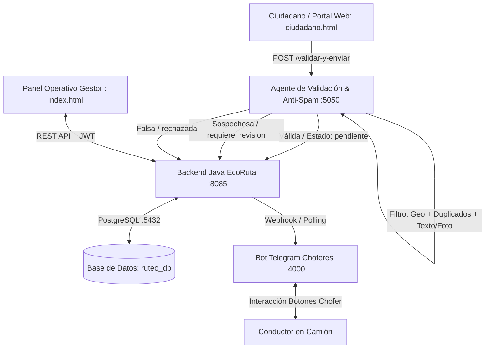

# EcoRuta - Plataforma Integral de Gestión y Ruteo Inteligente de Residuos 🌿🚚

**EcoRuta** es un ecosistema fullstack diseñado para la modernización de la recolección de residuos urbanos en Gran Asunción. Integra reporte ciudadano en tiempo real, validación automatizada mediante Inteligencia Artificial y reglas anti-spam, despacho logístico a camiones recolectores vía Telegram y panel operativo de optimización de rutas.

---

## 🏛️ Arquitectura del Sistema



---

## 📦 Módulos del Ecosistema

1. **Backend EcoRuta (`/backend`)**:
   - Desarrollado en **Java (JDK 17+)** sin frameworks pesados, con servidor HTTP ligero y pool PostgreSQL.
   - Endpoints REST para `/api/denuncias`, `/api/rutas`, `/api/clientes`, `/api/auth`, `/api/vehiculos`.
   - Soporte para tickets `ECO-XXXX`, categorización estándar y estados (`pendiente`, `en_proceso`, `cerrada`, `rechazada`, `requiere_revision`).

2. **Agente Validador & Anti-Spam (`/agent`)**:
   - Microservicio en **Node.js** (puerto `5050`).
   - Geovalidación perimetral de coordenadas en Gran Asunción.
   - Detección de reportes duplicados en radio de 150m (ventana de 48h).
   - Verificación de coherencia semántica descripción-foto según las 5 categorías oficiales.
   - Integración nativa con EcoRuta vía variable `ECORUTA_BACKEND_URL`.

3. **Portal Ciudadano (`/frontend/ciudadano.html`)**:
   - Interfaz moderna, accesible y responsive.
   - Geolocalización automática por GPS o selección interactiva en mapa Leaflet.
   - Seguimiento del estado del reporte y rastreo en tiempo real del camión recolector.

4. **Bot de Choferes de Camión (`/bot`)**:
   - Microservicio de despacho en **Node.js** con Telegram Bot API (`telegraf`).
   - Notificación de asignación de zonas y botones inline: *Aceptar Recolección*, *Navegar (Google Maps/Waze)* y *Marcar como Recolectado*.

5. **Panel del Gestor (`/frontend/index.html`)**:
   - Gestión integral de clientes, rutas optimizadas con OpenRouteService y panel de denuncias ciudadanas por barrio.

---

## 📋 Categorías Estándar de Residuos

* `VERTEDERO_CLANDESTINO`: Acumulaciones ilegales de basura en baldíos o vía pública.
* `CONTENEDOR_LLENO`: Campanas o contenedores públicos desbordados.
* `RESIDUO_VOLUMINOSO`: Muebles, electrodomésticos en desuso o chatarra.
* `RESTOS_PODA`: Ramas, troncos y desechos de jardinería comunitaria.
* `ANIMAL_MUERTO`: Retiro urgente de restos biológicos en calzada pública.

---

## 🚀 Guía de Instalación y Ejecución

### 1. Base de Datos PostgreSQL
1. Asegúrate de tener PostgreSQL ejecutándose en el puerto `5432`:
   ```sql
   CREATE DATABASE ruteo_db;
   ```
2. Ejecuta el esquema de inicialización:
   ```bash
   cd backend
   inicializar_db.bat
   ```

### 2. Backend Java
1. Compila y ejecuta el backend:
   ```bash
   cd backend
   compilar.bat
   ```
   *El backend quedará escuchando en `http://localhost:8085` (o `8080` según configuración).*

### 3. Agente de Validación Anti-Spam
1. Configura el archivo de entorno en `agent/`:
   ```bash
   cd agent
   copy .env.example .env
   npm install
   npm start
   ```
   *El agente iniciará en `http://localhost:5050`.*

2. Ejecución de pruebas del flujo de reportes:
   ```bash
   npm run test:report-flow
   ```

### 4. Bot de Telegram (Opcional para Choferes)
```bash
cd bot
copy .env.example .env
npm install
npm start
```

### 5. Frontend
Abre directamente en tu navegador web:
- **Portal Ciudadano EcoRuta**: `frontend/ciudadano.html`
- **Panel Administrativo / Gestor**: `frontend/index.html` (o ingresa mediante `frontend/login1.html`)

---

## 🧪 Pruebas del Agente Validador

El proyecto incluye el runner automatizado de pruebas `agent/scripts/test-report-flow.js` que verifica:
* **Caso 1: Denuncia Legítima** ➔ Aprobada con estado `pendiente` y enviada a EcoRuta con ticket `ECO-XXXX`.
* **Caso 2A: Denuncia Falsa / Texto incoherente** ➔ Rechazada por el agente.
* **Caso 2B: Coordenadas fuera de jurisdicción** ➔ Rechazada por geovalidación.
* **Caso 2C: Denuncia Duplicada** ➔ Marcada como sospechosa (`requiere_revision`) evitando duplicar recorridos de camiones.

Para ejecutarla en cualquier momento:
```bash
cd agent
npm run test:report-flow
```
